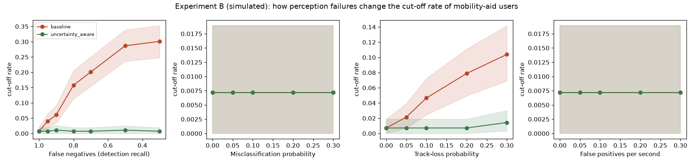
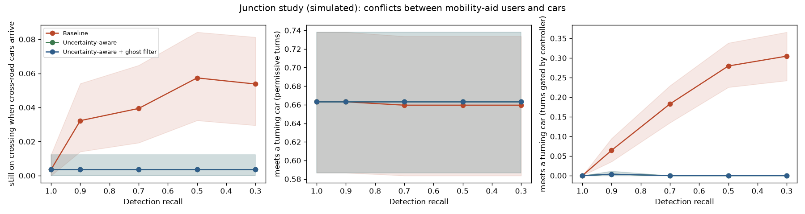
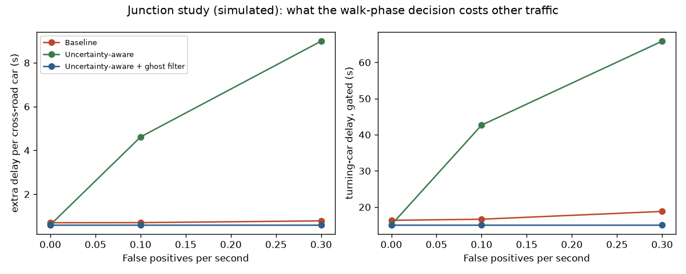

# SafeCross - results summary

Dataset for vision: `configs/pmma_dataset.yaml` | image size 1280 | IoU match 0.5

Everything below is copied from the CSV files in `results/`. Simulated results are labelled as simulated.

## Experiment A - does the camera find mobility-aid users? (MAAI901)

Models: pmma_yolo11s_seed0, pmma_yolo11s_seed1, pmma_yolo11s_seed2, yolo11s. Values are **found_as_person** (detected as any person, IoU >= 0.5) with 95% block-bootstrap intervals; `recall` (right class too) is in the CSV.

### Clean images, per group

| class | pmma_yolo11s_seed0 | pmma_yolo11s_seed1 | pmma_yolo11s_seed2 | yolo11s | fine-tuned mean | fine-tuned sd |
|---|---|---|---|---|---|---|
| ALL_MOBILITY_AIDS | 0.880 | 0.904 | 0.901 | 0.498 | 0.895 | 0.013 |
| cane | 0.880 | 0.874 | 0.913 | 0.825 | 0.889 | 0.021 |
| pedestrian | 0.885 | 0.867 | 0.873 | 0.883 | 0.875 | 0.009 |
| rollator | 0.839 | 0.894 | 0.857 | 0.559 | 0.863 | 0.028 |
| wheelchair | 0.908 | 0.932 | 0.920 | 0.220 | 0.920 | 0.012 |

### All mobility-aid users, clean and degraded

| condition | pmma_yolo11s_seed0 | pmma_yolo11s_seed1 | pmma_yolo11s_seed2 | yolo11s |
|---|---|---|---|---|
| blur 1 | 0.76 [0.71, 0.80] | 0.79 [0.75, 0.83] | 0.75 [0.70, 0.82] | 0.48 [0.44, 0.51] |
| blur 2 | 0.34 [0.30, 0.38] | 0.32 [0.29, 0.35] | 0.37 [0.34, 0.41] | 0.46 [0.41, 0.51] |
| blur 3 | 0.13 [0.10, 0.17] | 0.08 [0.06, 0.10] | 0.15 [0.11, 0.18] | 0.32 [0.30, 0.35] |
| clean 0 | 0.88 [0.84, 0.92] | 0.90 [0.87, 0.94] | 0.90 [0.86, 0.94] | 0.50 [0.46, 0.54] |
| darkness 1 | 0.89 [0.84, 0.93] | 0.89 [0.86, 0.92] | 0.92 [0.88, 0.95] | 0.51 [0.47, 0.55] |
| darkness 2 | 0.29 [0.25, 0.33] | 0.28 [0.24, 0.31] | 0.33 [0.29, 0.36] | 0.44 [0.37, 0.49] |
| darkness 3 | 0.00 [0.00, 0.00] | 0.00 [0.00, 0.00] | 0.00 [0.00, 0.00] | 0.04 [0.01, 0.06] |
| occlusion 1 | 0.53 [0.51, 0.56] | 0.49 [0.46, 0.52] | 0.54 [0.52, 0.56] | 0.22 [0.18, 0.26] |
| occlusion 2 | 0.23 [0.19, 0.25] | 0.14 [0.12, 0.16] | 0.18 [0.15, 0.21] | 0.05 [0.03, 0.07] |
| occlusion 3 | 0.07 [0.05, 0.10] | 0.02 [0.01, 0.04] | 0.03 [0.02, 0.05] | 0.01 [0.00, 0.01] |

Fine-tuned model over 3 training seeds (mean, sd):

| condition | mean | std |
|---|---|---|
| blur 1 | 0.766 | 0.019 |
| blur 2 | 0.344 | 0.027 |
| blur 3 | 0.121 | 0.035 |
| clean 0 | 0.895 | 0.013 |
| darkness 1 | 0.899 | 0.016 |
| darkness 2 | 0.300 | 0.027 |
| darkness 3 | 0.000 | 0.000 |
| occlusion 1 | 0.519 | 0.027 |
| occlusion 2 | 0.181 | 0.042 |
| occlusion 3 | 0.042 | 0.027 |

### Sensitivity check: looser box matching (IoU >= 0.3), clean images

| class | pmma_yolo11s_seed0 | yolo11s |
|---|---|---|
| ALL_MOBILITY_AIDS | 0.924 | 0.613 |
| cane | 0.880 | 0.825 |
| pedestrian | 0.918 | 0.887 |
| rollator | 1.000 | 0.857 |
| wheelchair | 0.908 | 0.300 |

## Experiment B - do camera failures cause unsafe signal decisions? (simulated)

279 mobility-aid crossings per condition. Cut-off rate = share of mobility-aid users still on the crossing when the walk phase ended.

| failure | level | controller | cut-off rate | mean_added_time_s | false_extension_rate |
|---|---|---|---|---|---|
| false_positive_rate | 0.000 | baseline | 0.01 [0.00, 0.02] | 0.624 | 0.000 |
| false_positive_rate | 0.000 | uncertainty_aware | 0.01 [0.00, 0.02] | 0.000 | 0.000 |
| false_positive_rate | 0.050 | baseline | 0.01 [0.00, 0.02] | 0.729 | 0.035 |
| false_positive_rate | 0.050 | uncertainty_aware | 0.01 [0.00, 0.02] | 5.451 | 0.445 |
| false_positive_rate | 0.100 | baseline | 0.01 [0.00, 0.02] | 0.768 | 0.045 |
| false_positive_rate | 0.100 | uncertainty_aware | 0.01 [0.00, 0.02] | 10.048 | 0.715 |
| false_positive_rate | 0.200 | baseline | 0.01 [0.00, 0.02] | 1.003 | 0.120 |
| false_positive_rate | 0.200 | uncertainty_aware | 0.01 [0.00, 0.02] | 16.680 | 0.905 |
| false_positive_rate | 0.300 | baseline | 0.01 [0.00, 0.02] | 1.190 | 0.175 |
| false_positive_rate | 0.300 | uncertainty_aware | 0.01 [0.00, 0.02] | 18.268 | 0.975 |
| misclassification_prob | 0.000 | baseline | 0.01 [0.00, 0.02] | 0.624 | 0.000 |
| misclassification_prob | 0.000 | uncertainty_aware | 0.01 [0.00, 0.02] | 0.000 | 0.000 |
| misclassification_prob | 0.050 | baseline | 0.01 [0.00, 0.02] | 0.624 | 0.000 |
| misclassification_prob | 0.050 | uncertainty_aware | 0.01 [0.00, 0.02] | 0.000 | 0.000 |
| misclassification_prob | 0.100 | baseline | 0.01 [0.00, 0.02] | 0.624 | 0.000 |
| misclassification_prob | 0.100 | uncertainty_aware | 0.01 [0.00, 0.02] | 0.000 | 0.000 |
| misclassification_prob | 0.200 | baseline | 0.01 [0.00, 0.02] | 0.624 | 0.000 |
| misclassification_prob | 0.200 | uncertainty_aware | 0.01 [0.00, 0.02] | 0.000 | 0.000 |
| misclassification_prob | 0.300 | baseline | 0.01 [0.00, 0.02] | 0.624 | 0.000 |
| misclassification_prob | 0.300 | uncertainty_aware | 0.01 [0.00, 0.02] | 0.000 | 0.000 |
| recall | 0.300 | baseline | 0.30 [0.25, 0.35] | 0.143 | 0.000 |
| recall | 0.300 | uncertainty_aware | 0.01 [0.00, 0.02] | 0.328 | 0.005 |
| recall | 0.500 | baseline | 0.29 [0.24, 0.34] | 0.215 | 0.000 |
| recall | 0.500 | uncertainty_aware | 0.01 [0.00, 0.02] | 0.203 | 0.005 |
| recall | 0.700 | baseline | 0.20 [0.15, 0.25] | 0.335 | 0.000 |
| recall | 0.700 | uncertainty_aware | 0.01 [0.00, 0.02] | 0.125 | 0.000 |
| recall | 0.800 | baseline | 0.16 [0.11, 0.21] | 0.385 | 0.000 |
| recall | 0.800 | uncertainty_aware | 0.01 [0.00, 0.02] | 0.111 | 0.005 |
| recall | 0.900 | baseline | 0.06 [0.03, 0.09] | 0.540 | 0.000 |
| recall | 0.900 | uncertainty_aware | 0.01 [0.00, 0.03] | 0.043 | 0.000 |
| recall | 0.950 | baseline | 0.04 [0.02, 0.06] | 0.576 | 0.000 |
| recall | 0.950 | uncertainty_aware | 0.01 [0.00, 0.02] | 0.019 | 0.000 |
| recall | 1.000 | baseline | 0.01 [0.00, 0.02] | 0.624 | 0.000 |
| recall | 1.000 | uncertainty_aware | 0.01 [0.00, 0.02] | 0.000 | 0.000 |
| track_loss_prob | 0.000 | baseline | 0.01 [0.00, 0.02] | 0.624 | 0.000 |
| track_loss_prob | 0.000 | uncertainty_aware | 0.01 [0.00, 0.02] | 0.000 | 0.000 |
| track_loss_prob | 0.050 | baseline | 0.02 [0.01, 0.04] | 0.599 | 0.000 |
| track_loss_prob | 0.050 | uncertainty_aware | 0.01 [0.00, 0.02] | 0.303 | 0.045 |
| track_loss_prob | 0.100 | baseline | 0.05 [0.02, 0.07] | 0.557 | 0.000 |
| track_loss_prob | 0.100 | uncertainty_aware | 0.01 [0.00, 0.02] | 0.586 | 0.105 |
| track_loss_prob | 0.200 | baseline | 0.08 [0.05, 0.11] | 0.502 | 0.000 |
| track_loss_prob | 0.200 | uncertainty_aware | 0.01 [0.00, 0.02] | 1.221 | 0.210 |
| track_loss_prob | 0.300 | baseline | 0.10 [0.07, 0.14] | 0.463 | 0.000 |
| track_loss_prob | 0.300 | uncertainty_aware | 0.01 [0.00, 0.03] | 1.604 | 0.260 |

## Junction study - what the decision means for cars at the junction (simulated follow-up)

279 mobility-aid crossings per condition, two-stage junction from configs/junction.yaml. Rates are shares of mobility-aid users with 95% episode-bootstrap intervals. 'gated' = the turn arrow is green only while the controller reports the crossing as clear.

| failure | level | controller | cutoff | cross_conflict | permissive_turn_conflict | gated_turn_conflict | cross_extra_delay_s | cross_green_lost_s | longer_cycle_share | permissive_turn_delay_s | gated_turn_delay_s |
|---|---|---|---|---|---|---|---|---|---|---|---|
| recall | 1.000 | baseline | 0.01 [0.00, 0.02] | 0.00 [0.00, 0.01] | 0.66 [0.59, 0.74] | 0.00 [0.00, 0.00] | 0.695 | 1.157 | 0.000 | 0.811 | 16.325 |
| recall | 1.000 | uncertainty_aware | 0.01 [0.00, 0.02] | 0.00 [0.00, 0.01] | 0.66 [0.59, 0.74] | 0.00 [0.00, 0.00] | 0.598 | 0.985 | 0.000 | 0.811 | 15.078 |
| recall | 1.000 | uncertainty_aware_filtered | 0.01 [0.00, 0.02] | 0.00 [0.00, 0.01] | 0.66 [0.59, 0.74] | 0.00 [0.00, 0.00] | 0.598 | 0.985 | 0.000 | 0.811 | 15.078 |
| recall | 0.900 | baseline | 0.06 [0.03, 0.09] | 0.03 [0.01, 0.05] | 0.66 [0.59, 0.74] | 0.06 [0.04, 0.09] | 0.328 | 0.562 | 0.000 | 0.714 | 14.597 |
| recall | 0.900 | uncertainty_aware | 0.01 [0.00, 0.03] | 0.00 [0.00, 0.01] | 0.66 [0.59, 0.74] | 0.00 [0.00, 0.01] | 0.610 | 1.004 | 0.000 | 0.811 | 15.178 |
| recall | 0.900 | uncertainty_aware_filtered | 0.01 [0.00, 0.03] | 0.00 [0.00, 0.01] | 0.66 [0.59, 0.74] | 0.00 [0.00, 0.01] | 0.610 | 1.004 | 0.000 | 0.811 | 15.178 |
| recall | 0.700 | baseline | 0.20 [0.15, 0.25] | 0.04 [0.02, 0.06] | 0.66 [0.58, 0.73] | 0.18 [0.13, 0.23] | 0.213 | 0.343 | 0.000 | 0.810 | 11.985 |
| recall | 0.700 | uncertainty_aware | 0.01 [0.00, 0.02] | 0.00 [0.00, 0.01] | 0.66 [0.59, 0.74] | 0.00 [0.00, 0.00] | 0.610 | 1.009 | 0.000 | 0.811 | 15.542 |
| recall | 0.700 | uncertainty_aware_filtered | 0.01 [0.00, 0.02] | 0.00 [0.00, 0.01] | 0.66 [0.59, 0.74] | 0.00 [0.00, 0.00] | 0.610 | 1.009 | 0.000 | 0.811 | 15.542 |
| recall | 0.500 | baseline | 0.29 [0.24, 0.34] | 0.06 [0.03, 0.08] | 0.66 [0.58, 0.73] | 0.28 [0.23, 0.34] | 0.059 | 0.114 | 0.000 | 0.712 | 9.701 |
| recall | 0.500 | uncertainty_aware | 0.01 [0.00, 0.02] | 0.00 [0.00, 0.01] | 0.66 [0.59, 0.74] | 0.00 [0.00, 0.00] | 0.627 | 1.030 | 0.000 | 0.852 | 15.205 |
| recall | 0.500 | uncertainty_aware_filtered | 0.01 [0.00, 0.02] | 0.00 [0.00, 0.01] | 0.66 [0.59, 0.74] | 0.00 [0.00, 0.00] | 0.627 | 1.030 | 0.000 | 0.852 | 15.180 |
| recall | 0.300 | baseline | 0.30 [0.25, 0.35] | 0.05 [0.03, 0.08] | 0.66 [0.58, 0.73] | 0.30 [0.24, 0.37] | 0.077 | 0.100 | 0.000 | 0.714 | 7.775 |
| recall | 0.300 | uncertainty_aware | 0.01 [0.00, 0.02] | 0.00 [0.00, 0.01] | 0.66 [0.59, 0.74] | 0.00 [0.00, 0.00] | 0.637 | 1.050 | 0.000 | 0.811 | 16.113 |
| recall | 0.300 | uncertainty_aware_filtered | 0.01 [0.00, 0.02] | 0.00 [0.00, 0.01] | 0.66 [0.59, 0.74] | 0.00 [0.00, 0.00] | 0.637 | 1.050 | 0.000 | 0.811 | 16.113 |
| false_positive_rate | 0.000 | baseline | 0.01 [0.00, 0.02] | 0.00 [0.00, 0.01] | 0.66 [0.59, 0.74] | 0.00 [0.00, 0.00] | 0.695 | 1.157 | 0.000 | 0.811 | 16.325 |
| false_positive_rate | 0.000 | uncertainty_aware | 0.01 [0.00, 0.02] | 0.00 [0.00, 0.01] | 0.66 [0.59, 0.74] | 0.00 [0.00, 0.00] | 0.598 | 0.985 | 0.000 | 0.811 | 15.078 |
| false_positive_rate | 0.000 | uncertainty_aware_filtered | 0.01 [0.00, 0.02] | 0.00 [0.00, 0.01] | 0.66 [0.59, 0.74] | 0.00 [0.00, 0.00] | 0.598 | 0.985 | 0.000 | 0.811 | 15.078 |
| false_positive_rate | 0.100 | baseline | 0.01 [0.00, 0.02] | 0.00 [0.00, 0.01] | 0.66 [0.59, 0.74] | 0.00 [0.00, 0.00] | 0.699 | 1.169 | 0.000 | 0.811 | 16.641 |
| false_positive_rate | 0.100 | uncertainty_aware | 0.01 [0.00, 0.02] | 0.00 [0.00, 0.01] | 0.66 [0.59, 0.74] | 0.00 [0.00, 0.00] | 4.616 | 7.678 | 0.000 | 0.564 | 42.667 |
| false_positive_rate | 0.100 | uncertainty_aware_filtered | 0.01 [0.00, 0.02] | 0.00 [0.00, 0.01] | 0.66 [0.59, 0.74] | 0.00 [0.00, 0.00] | 0.598 | 0.985 | 0.000 | 0.811 | 15.078 |
| false_positive_rate | 0.300 | baseline | 0.01 [0.00, 0.02] | 0.00 [0.00, 0.01] | 0.66 [0.59, 0.74] | 0.00 [0.00, 0.00] | 0.780 | 1.311 | 0.000 | 0.811 | 18.790 |
| false_positive_rate | 0.300 | uncertainty_aware | 0.01 [0.00, 0.02] | 0.00 [0.00, 0.01] | 0.66 [0.59, 0.74] | 0.00 [0.00, 0.00] | 8.991 | 14.231 | 0.000 | 0.326 | 65.884 |
| false_positive_rate | 0.300 | uncertainty_aware_filtered | 0.01 [0.00, 0.02] | 0.00 [0.00, 0.01] | 0.66 [0.59, 0.74] | 0.00 [0.00, 0.00] | 0.598 | 0.985 | 0.000 | 0.811 | 15.078 |
| track_loss_prob | 0.000 | baseline | 0.01 [0.00, 0.02] | 0.00 [0.00, 0.01] | 0.66 [0.59, 0.74] | 0.00 [0.00, 0.00] | 0.695 | 1.157 | 0.000 | 0.811 | 16.325 |
| track_loss_prob | 0.000 | uncertainty_aware | 0.01 [0.00, 0.02] | 0.00 [0.00, 0.01] | 0.66 [0.59, 0.74] | 0.00 [0.00, 0.00] | 0.598 | 0.985 | 0.000 | 0.811 | 15.078 |
| track_loss_prob | 0.000 | uncertainty_aware_filtered | 0.01 [0.00, 0.02] | 0.00 [0.00, 0.01] | 0.66 [0.59, 0.74] | 0.00 [0.00, 0.00] | 0.598 | 0.985 | 0.000 | 0.811 | 15.078 |
| track_loss_prob | 0.100 | baseline | 0.05 [0.02, 0.07] | 0.01 [0.00, 0.03] | 0.66 [0.59, 0.74] | 0.03 [0.01, 0.05] | 0.600 | 1.020 | 0.000 | 0.715 | 15.422 |
| track_loss_prob | 0.100 | uncertainty_aware | 0.01 [0.00, 0.02] | 0.00 [0.00, 0.01] | 0.66 [0.59, 0.74] | 0.00 [0.00, 0.00] | 0.697 | 1.156 | 0.000 | 0.717 | 18.431 |
| track_loss_prob | 0.100 | uncertainty_aware_filtered | 0.01 [0.00, 0.02] | 0.00 [0.00, 0.01] | 0.66 [0.59, 0.74] | 0.00 [0.00, 0.00] | 0.697 | 1.156 | 0.000 | 0.717 | 18.431 |
| track_loss_prob | 0.300 | baseline | 0.10 [0.07, 0.14] | 0.02 [0.00, 0.03] | 0.66 [0.59, 0.74] | 0.11 [0.07, 0.16] | 0.485 | 0.819 | 0.000 | 0.715 | 13.863 |
| track_loss_prob | 0.300 | uncertainty_aware | 0.01 [0.00, 0.03] | 0.00 [0.00, 0.01] | 0.66 [0.59, 0.74] | 0.00 [0.00, 0.01] | 0.852 | 1.461 | 0.000 | 0.554 | 21.311 |
| track_loss_prob | 0.300 | uncertainty_aware_filtered | 0.01 [0.00, 0.03] | 0.00 [0.00, 0.01] | 0.66 [0.59, 0.74] | 0.00 [0.00, 0.01] | 0.852 | 1.461 | 0.000 | 0.554 | 21.311 |

## Explanations - are the vision-language model's explanations faithful? (MAAI902)

Question set (true answers): counterfactual no: 26, counterfactual yes: 40, counterfactual_rules no: 26, counterfactual_rules yes: 40, decision confirmed_occupancy: 43, decision crossing_clear: 110, decision max_phase_reached: 10, decision mobility_aid_on_crossing: 27, decision uncertain_occupancy_lost_track: 16, visual no: 29, visual yes: 31, visual_real no: 60, visual_real yes: 60

### offline_rules (rule-based reference, NOT an AI model)

| qtype | condition | factual_correct | controller_faithful | visually_grounded | abstained | hallucinated_citation |
|---|---|---|---|---|---|---|
| counterfactual | image_log | 0.879 | 0.879 |  | 0.000 | 0.000 |
| counterfactual | image_only | 0.394 | 0.000 |  | 0.000 | 0.000 |
| counterfactual | log_only | 0.879 | 0.879 |  | 0.000 | 0.000 |
| counterfactual_rules | image_log | 0.879 | 0.879 |  | 0.000 | 0.000 |
| counterfactual_rules | image_only | 0.394 | 0.000 |  | 0.000 | 0.000 |
| counterfactual_rules | log_only | 0.879 | 0.879 |  | 0.000 | 0.000 |
| decision | image_log | 1.000 | 1.000 |  | 0.000 | 0.000 |
| decision | image_only | 0.000 | 1.000 |  | 1.000 | 0.000 |
| decision | log_only | 1.000 | 1.000 |  | 0.000 | 0.000 |
| visual | image_log | 0.000 |  | 0.000 | 1.000 | 0.000 |
| visual | image_only | 0.000 |  | 1.000 | 1.000 | 0.000 |
| visual | log_only | 0.000 |  | 1.000 | 1.000 | 0.000 |
| visual_real | image_log | 0.000 |  | 0.000 | 1.000 | 0.000 |
| visual_real | image_only | 0.000 |  | 1.000 | 1.000 | 0.000 |
| visual_real | log_only | 0.000 |  | 1.000 | 1.000 | 0.000 |

- decision: picture+log 1.000 vs log only 1.000 (n=206, McNemar p=1.000)
- visual: picture+log 0.000 vs log only 0.000 (n=60, McNemar p=1.000)
- visual_real: picture+log 0.000 vs log only 0.000 (n=120, McNemar p=1.000)
- what-if (image_log), follow-up: with controller rules 0.879 vs without 0.879 (n=66, McNemar p=1.000)
- what-if (log_only), follow-up: with controller rules 0.879 vs without 0.879 (n=66, McNemar p=1.000)
- counterfactual answers (picture+log): model {'yes': 46, 'no': 20} vs truth {'yes': 40, 'no': 26}
- counterfactual_rules answers (picture+log): model {'yes': 46, 'no': 20} vs truth {'yes': 40, 'no': 26}
- visual_real answers (picture+log): model {'cannot_determine': 120} vs truth {'yes': 60, 'no': 60}

### ollama_llava_7b

| qtype | condition | factual_correct | controller_faithful | visually_grounded | abstained | hallucinated_citation |
|---|---|---|---|---|---|---|
| counterfactual | image_log | 0.833 | 0.833 |  | 0.000 | 0.000 |
| counterfactual | image_only | 0.000 | 0.939 |  | 0.939 | 0.227 |
| counterfactual | log_only | 0.682 | 0.682 |  | 0.000 | 0.000 |
| counterfactual_rules | image_log | 0.500 | 0.500 |  | 0.000 | 0.000 |
| counterfactual_rules | image_only | 0.212 | 0.227 |  | 0.227 | 0.121 |
| counterfactual_rules | log_only | 0.712 | 0.712 |  | 0.000 | 0.000 |
| decision | image_log | 0.956 | 0.883 |  | 0.000 | 0.000 |
| decision | image_only | 0.034 | 0.519 |  | 0.519 | 0.010 |
| decision | log_only | 1.000 | 1.000 |  | 0.000 | 0.000 |
| visual | image_log | 0.000 |  | 0.000 | 0.983 | 0.983 |
| visual | image_only | 0.000 |  | 0.950 | 0.950 | 0.950 |
| visual | log_only | 0.000 |  | 0.967 | 0.967 | 0.983 |
| visual_real | image_log | 0.483 |  | 0.483 | 0.108 | 1.000 |
| visual_real | image_only | 0.000 |  | 1.000 | 1.000 | 0.767 |
| visual_real | log_only | 0.500 |  | 0.033 | 0.033 | 1.000 |

- decision: picture+log 0.956 vs log only 1.000 (n=206, McNemar p=0.004)
- visual: picture+log 0.000 vs log only 0.000 (n=60, McNemar p=1.000)
- visual_real: picture+log 0.483 vs log only 0.500 (n=120, McNemar p=0.500)
- what-if (image_log), follow-up: with controller rules 0.500 vs without 0.833 (n=66, McNemar p=0.000)
- what-if (log_only), follow-up: with controller rules 0.712 vs without 0.682 (n=66, McNemar p=0.824)
- counterfactual answers (picture+log): model {'yes': 35, 'no': 31} vs truth {'yes': 40, 'no': 26}
- counterfactual_rules answers (picture+log): model {'yes': 7, 'no': 59} vs truth {'yes': 40, 'no': 26}
- visual_real answers (picture+log): model {'yes': 107, 'cannot_determine': 13} vs truth {'yes': 60, 'no': 60}

### ollama_qwen2.5vl_7b

| qtype | condition | factual_correct | controller_faithful | visually_grounded | abstained | hallucinated_citation |
|---|---|---|---|---|---|---|
| counterfactual | image_log | 0.394 | 0.394 |  | 0.000 | 0.000 |
| counterfactual | image_only | 0.394 | 0.000 |  | 0.000 | 0.000 |
| counterfactual | log_only | 0.379 | 0.379 |  | 0.015 | 0.000 |
| counterfactual_rules | image_log | 0.394 | 0.394 |  | 0.000 | 0.000 |
| counterfactual_rules | image_only | 0.394 | 0.000 |  | 0.000 | 0.000 |
| counterfactual_rules | log_only | 0.394 | 0.394 |  | 0.000 | 0.000 |
| decision | image_log | 1.000 | 1.000 |  | 0.000 | 0.000 |
| decision | image_only | 0.743 | 0.000 |  | 0.000 | 0.000 |
| decision | log_only | 1.000 | 1.000 |  | 0.000 | 0.000 |
| visual | image_log | 0.483 |  | 0.383 | 0.000 | 0.783 |
| visual | image_only | 0.483 |  | 0.000 | 0.000 | 0.883 |
| visual | log_only | 0.417 |  | 0.083 | 0.083 | 0.067 |
| visual_real | image_log | 0.517 |  | 0.517 | 0.000 | 0.708 |
| visual_real | image_only | 0.483 |  | 0.050 | 0.050 | 0.917 |
| visual_real | log_only | 0.408 |  | 0.142 | 0.142 | 0.233 |

- decision: picture+log 1.000 vs log only 1.000 (n=206, McNemar p=1.000)
- visual: picture+log 0.483 vs log only 0.417 (n=60, McNemar p=0.388)
- visual_real: picture+log 0.517 vs log only 0.408 (n=120, McNemar p=0.002)
- what-if (image_log), follow-up: with controller rules 0.394 vs without 0.394 (n=66, McNemar p=1.000)
- what-if (log_only), follow-up: with controller rules 0.394 vs without 0.379 (n=66, McNemar p=1.000)
- counterfactual answers (picture+log): model {'no': 66} vs truth {'yes': 40, 'no': 26}
- counterfactual_rules answers (picture+log): model {'no': 66} vs truth {'yes': 40, 'no': 26}
- visual_real answers (picture+log): model {'yes': 118, 'no': 2} vs truth {'yes': 60, 'no': 60}

## Notes for the papers
- PMMA frames come from one outdoor parking-area video; training and test frames are separated in time (an optimistic, same-scene estimate). Cite Liu, Saunier & Bilodeau (2025), doi:10.5683/SP3/XJPQUG.
- Confidence intervals in Experiment A resample 2-second blocks of frames, not single images.
- Experiment B is a simulation with configurable assumptions (configs/config.yaml).
- The junction study is a follow-up simulation (configs/junction.yaml): two signal stages, Poisson car arrivals, no real traffic data. Phantom detections in the simulation do not move, so the ghost filter removes them completely; real false positives can move, so its real benefit will be smaller.
- The 'what if with rules' and balanced picture questions were added after the first explanation run; report them as follow-up analyses.
